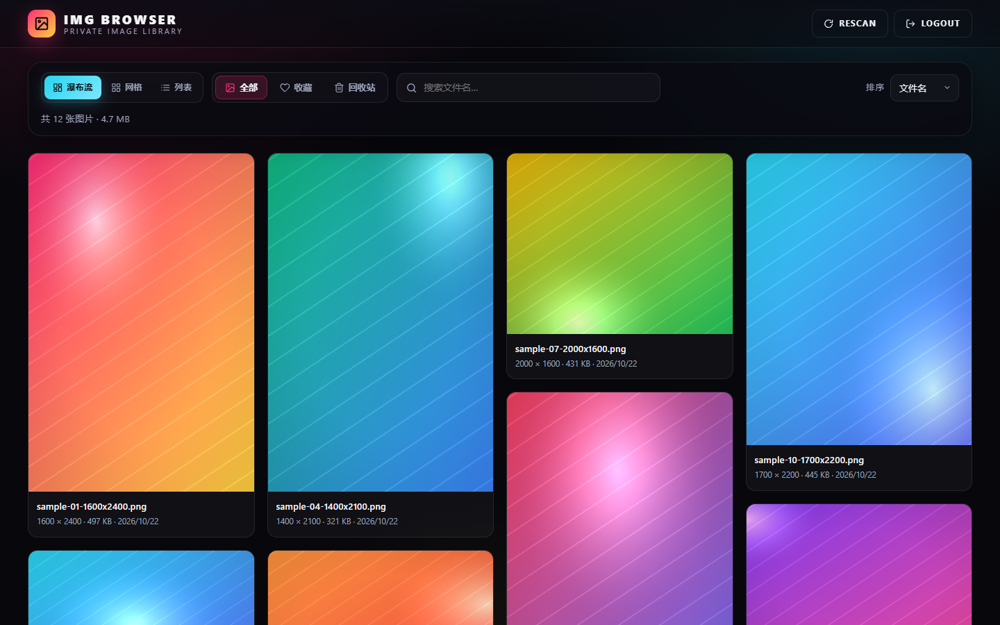
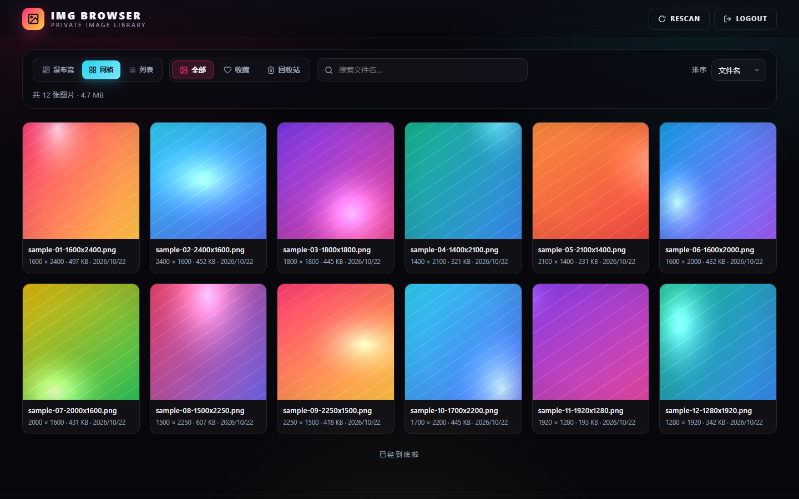
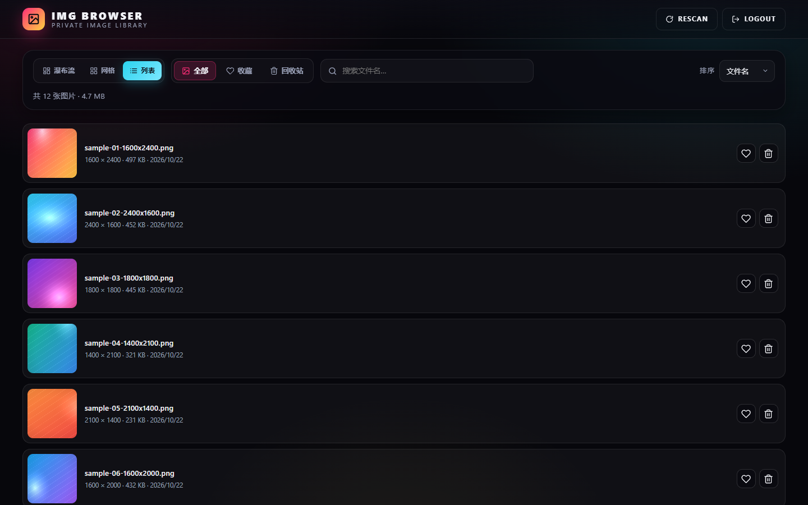
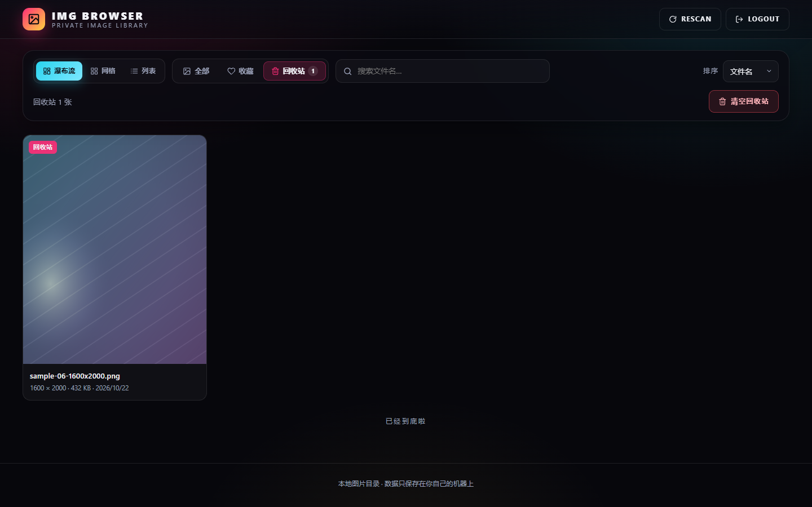
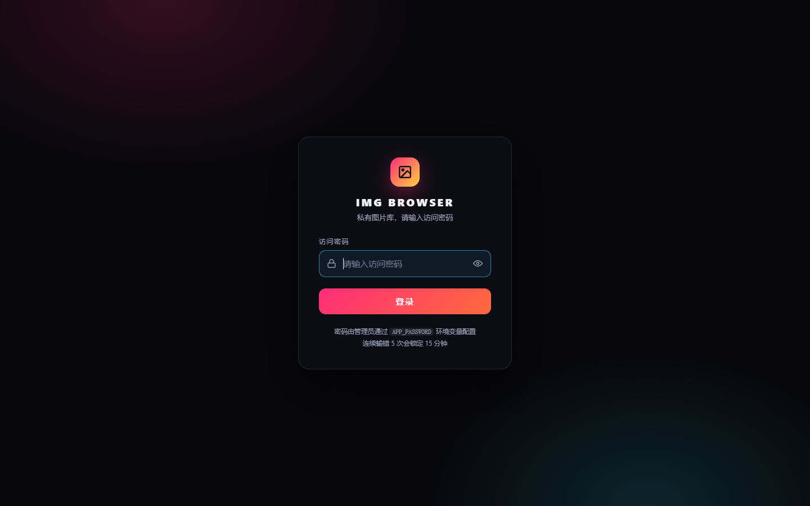
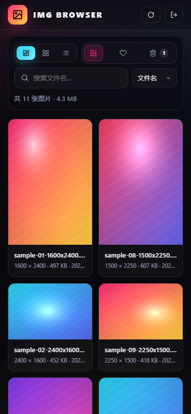

# ImgBrowser 图片浏览器

一个跑在自己机器上的私有图片浏览器：把一个本地目录挂进来，就能以瀑布流 / 网格 / 列表三种方式浏览，
支持搜索、收藏、回收站和大图查看。数据全部存在本地 SQLite，不上传任何地方。



## 功能

- **三种视图**：瀑布流（按真实比例排列）、网格、列表，选择会被记住
- **真实元数据**：服务端读取图片文件头解析宽高，卡片显示 `宽 × 高 · 体积 · 修改日期`，并用真实比例占位避免加载时跳动
- **服务端分页 + 无限滚动**：SQL 层 `LIMIT/OFFSET`，图片再多也只查一页
- **文件名搜索**：服务端 `LIKE` 过滤，与分页、排序、分类组合生效
- **收藏 / 回收站**：删除先移入回收站，可恢复或永久删除；回收站文件名带 id 前缀，不会互相覆盖
- **大图查看**：上一张/下一张、1×–4× 缩放、拖拽平移、键盘快捷键
- **增量扫描**：启动时自动同步目录，也可以点 `RESCAN` 随时重新扫描（新增/更新/清理）
- **密码保护**：登录后所有页面、接口**以及图片文件**都需要会话，登录失败 5 次锁定 15 分钟
- **离线可用**：图标内联为 SVG，不依赖任何 CDN，内网/断网环境不会变成方块
- **响应式 & 可访问性**：移动端两列布局、键盘可操作、axe 审计 0 violations

## 截图

| 网格视图 | 列表视图 |
| --- | --- |
|  |  |

| 大图查看 | 回收站 |
| --- | --- |
|  |  |

| 登录页 | 移动端 |
| --- | --- |
|  |  |

> 截图使用脚本生成的占位图片，不包含任何真实照片。

## 快速开始

### 环境要求

- Node.js **18.18+**（推荐 20 / 22 LTS）
- npm 或 pnpm / yarn

### 安装与运行

```bash
npm install

# 1. 准备配置（必填 APP_PASSWORD）
cp .env.example .env
#    然后编辑 .env，至少改掉 APP_PASSWORD

# 2. 把图片放进 IMAGES_DIR 指向的目录（默认 ./images）
mkdir -p images && cp /path/to/photos/*.jpg images/

# 3. 开发模式（热重载）
npm run dev

# 或者生产模式
npm run build && npm run serve
```

打开 <http://localhost:3000>，输入 `.env` 里的密码即可。
首次启动会自动扫描图片目录、创建数据库（`imgbrowser.db`）和回收站目录（`remove/`）。

### 配置

配置项通过环境变量或项目根目录的 `.env` 提供（已存在的环境变量优先，不会被 `.env` 覆盖）。
`.env` 解析支持注释、引号和 Windows 常见的 UTF-8 BOM。

| 变量 | 默认值 | 说明 |
| --- | --- | --- |
| `APP_PASSWORD` | **必填** | 访问密码，缺失时进程直接退出 |
| `PORT` | `3000` | 监听端口 |
| `HOST` | `0.0.0.0` | 监听地址，只允许本机访问可设为 `127.0.0.1` |
| `IMAGES_DIR` | `./images` | 图片库目录（浏览的原始图片） |
| `TRASH_DIR` | `./remove` | 回收站目录，删除的图片移动到这里 |
| `DB_PATH` | `./imgbrowser.db` | SQLite 数据库文件 |
| `SESSION_TTL_HOURS` | `24` | 会话有效期（滑动续期） |
| `MAX_PAGE_SIZE` | `100` | 接口单页最大条数，超出会被截断 |
| `DEFAULT_PAGE_SIZE` | `24` | 未传 `limit` 时的默认条数 |
| `TRUST_PROXY` | `0` | 置于 Nginx/Caddy 之后时设为 `1`，用于取真实 IP 与 `https` 协议 |
| `NODE_ENV` | - | 设为 `production` 时行为不变，仅供部署环境标注 |

相对路径一律基于**启动进程的工作目录**（即项目根目录）解析。

## Docker 部署

```bash
cp .env.example .env        # 修改 APP_PASSWORD 与 APP_PORT
mkdir -p images             # 宿主机图片目录（容器内只读挂载点）
docker compose up -d --build
```

默认映射到 <http://localhost:8211>。容器内以非 root 用户（uid 1000）运行，
数据库与回收站使用命名卷 `imgbrowser-data` / `imgbrowser-trash`，重建容器不会丢失收藏与回收站状态。

单独使用 `docker run`：

```bash
docker build -t imgbrowser .
docker run -d --name imgbrowser -p 8211:3000 \
  -e APP_PASSWORD='你的密码' \
  -v "$(pwd)/images:/app/images" \
  -v imgbrowser-data:/app/data \
  -v imgbrowser-trash:/app/remove \
  imgbrowser
```

> **Linux 权限提示**：容器内用户是 uid 1000。若宿主机的 `images` 目录属于其他用户，
> 恢复图片时会写入失败；可用 `chown -R 1000:1000 images`，或在 compose 中加 `user: "$(id -u):$(id -g)"`。

## API

除 `/api/health`、`/api/auth/status`、`/api/login`、`/api/logout` 外，所有接口都需要登录
（会话 Cookie `sessionId`，`HttpOnly` + `SameSite=Strict`）。
未登录访问页面或图片会 302 到登录页，访问 `/api/*` 返回 `401 {"error":"..."}`。

### 认证

| 方法 | 路径 | 说明 |
| --- | --- | --- |
| POST | `/api/login` | 请求体 `{"password":"..."}`；成功返回 `{"success":true}` 并写入 Cookie |
| POST | `/api/logout` | 销毁当前会话 |
| GET | `/api/auth/status` | `{"authenticated":true|false}` |
| GET | `/api/health` | `{"status":"ok","uptime":秒,"version":"1.1.0"}`，供健康检查使用 |

登录失败同一 IP 连续 5 次后锁定 15 分钟，返回 `429` 并带 `Retry-After`。

### 获取图片列表

`GET /api/images`

| 参数 | 类型 | 默认 | 说明 |
| --- | --- | --- | --- |
| `page` | integer | `1` | 页码，非法值回退为 1 |
| `limit` | integer | `24` | 每页条数，上限 `MAX_PAGE_SIZE`（默认 100） |
| `sort` | string | `name` | `name` 文件名 / `newest` 最新修改 / `oldest` 最旧修改 |
| `show` | string | `all` | `all` 全部 / `favorites` 收藏 / `trash` 回收站（兼容旧值 `deleted`） |
| `q` | string | - | 文件名模糊搜索，最长 120 字符 |

```json
{
  "images": [
    {
      "id": 12,
      "filename": "sample-01.png",
      "url": "/images/sample-01.png",
      "path": "/images/sample-01.png",
      "width": 1600,
      "height": 2400,
      "size": 508412,
      "mtime": 1761081600000,
      "favorited": false,
      "deleted": false,
      "deleted_at": null,
      "created_at": "2026-10-22 01:51:23"
    }
  ],
  "pagination": {
    "page": 1,
    "limit": 24,
    "total": 12,
    "totalPages": 1,
    "hasNext": false,
    "hasPrev": false
  },
  "query": { "page": 1, "limit": 24, "sort": "name", "show": "all", "q": "" }
}
```

- `url` 是**相对路径**（1.0 版本返回绝对地址），反向代理、跨域访问时都不需要额外处理
- `query` 是服务端实际生效的参数，参数被截断时可以据此对齐前端状态
- 回收站中的图片 `deleted: true`，`url` 指向 `/removed/...`

### 图片操作

| 方法 | 路径 | 说明 | 响应 |
| --- | --- | --- | --- |
| POST | `/api/images/:id/favorite` | 切换收藏 | `{"success":true,"favorited":true}` |
| POST | `/api/images/:id/delete` | 移入回收站 | `{"success":true,"deleted_at":"..."}` |
| POST | `/api/images/:id/restore` | 从回收站恢复 | `{"success":true,"filename":"...","path":"/images/..."}` |
| DELETE | `/api/images/:id` | 永久删除（连同磁盘文件） | `{"success":true}` |
| POST | `/api/trash/empty` | 清空回收站 | `{"success":true,"deletedCount":3}` |
| POST | `/api/scan` | 重新扫描图片目录 | `{"success":true,"added":2,"updated":0,"removed":1,"total":12,"durationMs":31}` |
| GET | `/api/stats` | 统计信息 | 见下 |

`POST /api/init` 是 `/api/scan` 的兼容别名，保留给旧脚本。

```json
{ "total": 11, "favorites": 2, "trashed": 1, "all": 12, "bytes": 4931200 }
```

`total` 不含回收站，`all` 含回收站，`bytes` 为未删除图片的总字节数。

**状态码**：`400` 参数非法 · `401` 未登录 · `404` 图片不存在 · `409` 状态冲突（重复删除 / 重复恢复） ·
`429` 登录过于频繁 · `500` 服务端错误。

## 键盘与鼠标操作

| 场景 | 快捷键 |
| --- | --- |
| 列表页 | `/` 聚焦搜索框；`Esc` 清空搜索 |
| 大图查看 | `←` `→` 上一张/下一张；`Esc` 关闭；`F` 收藏；`D` 删除 |
| 缩放 | `+` 放大；`-` 缩小；`0` 还原；双击在 1× / 2× 间切换 |
| 拖拽 | 放大后按住拖动平移（触屏同样支持） |

## 项目结构

```
imgbrowser/
├── src/
│   ├── server.ts        # Express 应用：路由、鉴权、限流、静态资源
│   ├── db.ts            # SQLite 访问层：迁移、查询、回收站、增量扫描
│   ├── imageSize.ts     # 从 PNG/JPEG/GIF/BMP/WebP 文件头读宽高
│   └── config.ts        # 环境变量与路径解析
├── public/              # 原生 HTML/CSS/JS 前端（无构建步骤）
│   ├── index.html       # 主页面 + 内联 SVG 图标
│   ├── script.js        # 浏览、搜索、收藏、大图查看
│   ├── style.css
│   ├── login.html / login.css / login.js
│   └── favicon.svg
├── docs/screenshots/    # 文档截图
├── images/              # 默认图片库目录（被 .gitignore 忽略）
├── remove/              # 回收站（运行时创建）
├── imgbrowser.db        # SQLite 数据库（运行时创建，WAL 模式）
├── Dockerfile           # 多阶段构建，非 root 运行
├── docker-compose.yml
├── .env.example
└── README.md
```

## 实现要点

**安全**

- 图片与回收站文件同样需要登录：1.0 版本把 `/images` 交给 `express.static`，只要猜到文件名就能绕过密码
- 静态资源走白名单路由，`/images`、`/removed` 自行解析路径并做 `path.resolve` 前缀校验，阻止 `../` 穿越
- CSP 仅允许同源脚本与样式（前端已无任何 CDN 依赖），并附带 `nosniff` / `X-Frame-Options` / `Referrer-Policy`
- 登录使用 SHA-256 + `timingSafeEqual` 常量时间比较，配合按 IP 的失败计数限流

**性能**

- 列表查询在 SQL 层完成过滤、排序与分页；1.0 版本每次请求都会取出全表再在 JS 里切片
- 扫描为增量：按 `size + mtime` 判断变化，只为新增/变动的文件解析尺寸；单文件 64KB 头读取
- 卡片用服务端宽高写入 `aspect-ratio` 占位，图片加载完成前不会触发瀑布流重排

**正确性**

- 会话改为滑动过期，活跃用户不会在固定 24 小时后被踢出
- 回收站文件名带 id 前缀，不同目录的同名文件不会互相覆盖；恢复时自动避让重名
- 关闭数据库前等待连接真正释放，信号处理可优雅退出
- 前端所有用户数据都用 `textContent` 渲染，文件名中的 `` 不会被当成 HTML

## 从 1.0 升级

无需手动迁移，启动时会自动补列并建立唯一索引。需要注意的行为变化：

| 变化 | 说明 |
| --- | --- |
| `IMAGES_DIR` 默认值 | 由硬编码的 `C:\Users\...\Downloads` 改为 `./images`，请用 `.env` 指定真实目录 |
| 图片需要登录 | 直接访问 `/images/xxx.png` 不再返回文件，未登录会跳转登录页 |
| 列表接口 `url` | 由绝对地址改为相对路径 |
| `sort=newest/oldest` | 改为按文件修改时间排序（1.0 用的是入库时间，重扫后顺序无意义） |
| `show=deleted` | 改为 `show=trash`，旧值仍然兼容 |
| `GET /api/stats` | 返回 `total / favorites / trashed / all / bytes`，`total` 不再包含回收站 |
| `POST /api/init` | 改名为 `POST /api/scan`，旧路径保留为别名 |
| 前端资源 | 不再依赖 Font Awesome 与 Google Fonts 的 CDN |

## 常见问题

**图片列表是空的？**
确认 `IMAGES_DIR` 指向的目录存在且包含受支持的扩展名（`.jpg .jpeg .png .gif .bmp .webp .avif`），
然后点击页面右上角的 `RESCAN`，或看启动日志里的 `[scan]` 一行。

**端口被占用？**
启动日志会提示 `端口 xxxx 已被占用`，改 `PORT` 即可。

**忘记密码？**
改 `.env` 里的 `APP_PASSWORD` 后重启进程，已有会话随之失效。

**删除的图片去哪了？**
在 `TRASH_DIR`（默认 `remove/`）下，文件名形如 `12__photo.jpg`。清空回收站或永久删除才会真正删掉文件。

**能不能只看不删？**
把 `images` 目录以只读方式挂载给容器，删除会失败并提示错误，浏览/收藏不受影响。

**反向代理后登录一直失败/限流失效？**
设置 `TRUST_PROXY=1`，让服务端从 `X-Forwarded-For` / `X-Forwarded-Proto` 取真实信息。

## 开发命令

```bash
npm run dev        # ts-node + nodemon 热重载
npm run typecheck  # 只做类型检查
npm run build      # 编译到 dist/
npm run serve      # 运行编译产物
npm run clean      # 删除 dist/
```

## 变更记录

见 [CHANGELOG.md](CHANGELOG.md)。

## 许可证

ISC
